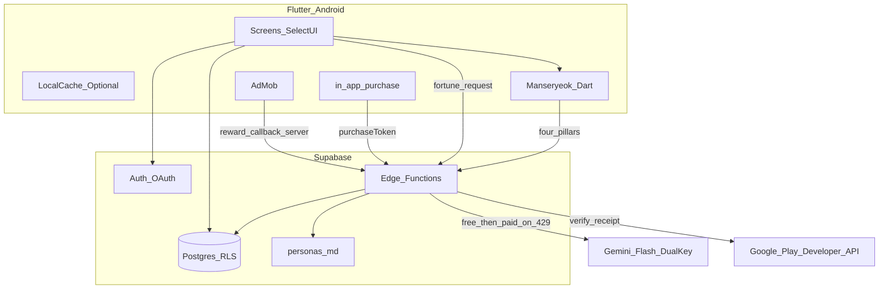

# 가화만사성 설계안

> 기준 문서: [가화만사성 기획안.md](../가화만사성%20기획안.md), [RULE.md](../RULE.md)  
> 확정: **1차 출시 = 전체 기능(A안)** · **민감정보만 DB 금지(일반 프로필·사주 입력은 DB 가능)** · **결제 = 인앱결제(IAP)만**

---

## 1. 목표·범위

### 1.1 제품 목표
- 비싼 사주 대신 Gemini 기반 **가족/동료 궁합, 택일, 작명, 꿈해몽, 내 운세**를 간단히 제공
- Google Play 출시 (`com.janny.gahwa_luck`), AdMob + IAP 수익화
- 어르신도 쓸 수 있는 **선택형 UI**, 재화(부적/쌀알)로 이용량 제어

### 1.2 1차 출시 범위 (A안 — 한 번에)
| 영역 | 포함 |
|------|------|
| 인증 | Google + Kakao OAuth (네이버는 2차) |
| 온보딩 | 프로필(본인) + 가족/지인 등록 |
| 기능 | 내 운세, 가족궁합, 동료궁합, 날 받기, 이름받기, 꿈해몽 |
| 재화 | 부적/쌀알, 일일 무료, 리워드 광고, IAP(소비성+30일 패스) |
| 광고 | 하단 배너, 리워드, LLM 대기 중 네이티브 |
| 설정 | 히스토리, 상점, 약관/면책, 탈퇴, 문의 |
| 품질 | fortunes/chats DB 기록, 결제 최소 로그 |

### 1.3 명시적 후속
- iOS 앱스토어 (약 1년 후)
- 네이버 로그인, 초대 코드 바이럴(필요 시 1차 말 스코프에 포함 가능 — 기본은 출시 직후)

---

## 2. 아키텍처



### 2.1 책임 분리
| 구성 | 책임 |
|------|------|
| Flutter | 화면, 선택형 입력, 만세력 선계산, AdMob 표시, IAP 구매 시작 |
| Edge `generate-fortune` | 부적 차감 → 페르소나+프롬프트 → Gemini → fortunes 저장 |
| Edge `ask-followup` | 쌀알 차감 → 슬라이딩 윈도우 → Gemini → chats 저장 |
| Edge `verify-iap` | Play 영수증 검증 → 재화/패스 지급 → purchases 로그 |
| Edge `claim-reward` / `daily-grant` | 광고 보상·일일 지급(서버 일자기준 KST) |
| DB | users, members, fortunes, chats, purchases, wallet_ledger |

### 2.2 Dual-Key LLM
1. `GEMINI_API_KEY_FREE` (jadissproject) 호출  
2. HTTP 429 → `GEMINI_API_KEY_PAID` (wndhksdl92) 즉시 재시도  
3. 운영자가 시크릿만 교체해 유료 전환 가능

---

## 3. 보안·개인정보

### 3.1 민감정보 vs 일반 개인정보 (확정)
| 구분 | 예시 | 저장 |
|------|------|------|
| 일반 개인정보 | 이름, 한자, 생년월일, 출생시, 양/음력, 성별, MBTI, 관계 | **Supabase DB 허용** (목적 내, RLS, 탈퇴 삭제) |
| 민감정보 | 질병/건강진단, 생체인식, 성생활, 사상·신념, 범죄경력 등 | **저장 금지** (프롬프트에도 수집 UI 두지 않음) |

꿈해몽의 “감정/스토리”는 오락용 입력이며 의료·진단 데이터로 취급·저장 문구를 쓰지 않는다. 건강·질병을 묻는 필드/로그를 만들지 않는다.

### 3.2 기타 보안
- Gemini·Play 서비스계정·OAuth secret: Edge/CI만
- 앱: `SUPABASE_URL` + `anon` key만
- RLS: 본인 row만 CRUD
- 재화는 서버 트랜잭션만 증감
- 로컬 캐시(선택): 오프라인 표시용 미러, **출처 of truth는 DB**

---

## 4. 데이터 모델 (Postgres)

### 4.1 `users`
| 컬럼 | 설명 |
|------|------|
| id (uuid, = auth.uid) | PK |
| email, provider | OAuth 최소 |
| amulet_count, rice_count | 지갑 |
| last_daily_charge_date | KST 날짜 문자열 |
| daily_ad_view_count | 일일 리워드 한도 |
| pass_active, pass_expired_at | 30일 패스 |
| my_profile (jsonb) | 본인 사주 프로필 |
| created_at, updated_at | |

### 4.2 `members`
가족/동료 목록 (정규화 — 조회·삭제 용이)

| 컬럼 | 설명 |
|------|------|
| id, user_id | |
| name, hanja, relation, priority | |
| birth_date, birth_time, is_lunar, gender, mbti | |
| kind | `family` \| `colleague` \| `other` |

### 4.3 `fortunes`
| 컬럼 | 설명 |
|------|------|
| id, user_id, category | family/colleague/date_pick/naming/dream/my_fortune |
| input_summary (jsonb) | 당시 입력(일반 개인정보 포함 가능) |
| four_pillars (jsonb) | 클라이언트 확정 간지 |
| result_json (jsonb) | Gemini JSON |
| result_text | 표시/검색용 요약 또는 원문 |
| remaining_rice_turns | 기본 5 |
| created_at | |

### 4.4 `fortune_chats`
| turn_index (1~5), user_question, ai_answer, created_at |

### 4.5 `purchases` (IAP)
| purchase_token (unique), product_id, order_id, user_id, status, raw_payload, created_at |

### 4.6 `wallet_ledger` (감사)
| delta_amulet, delta_rice, reason, ref_id, created_at |

---

## 5. 인앱결제 (IAP) 설계

### 5.1 상품 (Play Console managed products)
| product_id (예시) | 유형 | 지급 |
|-------------------|------|------|
| `amulet_1` | 소비성 | 부적 1 |
| `amulet_10` | 소비성 | 부적 10 |
| `amulet_30` | 소비성 | 부적 30 |
| `rice_1` / `rice_10` / `rice_30` | 소비성 | 쌀알 |
| `pass_30d` | 비소모(또는 managed, 기간은 서버가 +30일) | 패스 활성화 + 일일 한도 상향 |

가격 UI는 콘솔 표시가와 맞추고, 기획 단가(800원 등)는 콘솔에 등록한 값을 따른다.

### 5.2 흐름
```
앱 in_app_purchase.buy → 구매 성공 콜백
  → Edge verify-iap(purchaseToken, productId)
  → Play Developer API acknowledge/verify
  → purchases INSERT (token UNIQUE)
  → users 지갑/패스 갱신 + ledger
  → 앱 잔액 리프레시
```

환불: Play Voided Purchases API 또는 콘솔 알림 연동 시 패스 무효·잔여 소모분 정책은 “이미 사용한 재화는 회수 최선, 패스는 즉시 만료”로 구현.

---

## 6. 재화·광고 정책

| 구분 | 일반 | 패스(30일) |
|------|------|------------|
| 매일 00:00 KST | 부적 1, 쌀알 3 | 부적 5, 쌀알 15로 **리셋**(미사용 이월 없음) |
| 풀이 1회 | 부적 1 | 동일 |
| 추가질문 1회 | 쌀알 1 (fortune당 최대 5) | 동일 |
| 리워드 광고 | 부적 1 또는 쌀알 3 (서버 한도) | 소진 후 자발적 시청 유지 |
| 배너/생성중 네이티브 | 표시 | 배너 숨김, 리워드 유지 |

LLM 대기 UX: 부적 회전 + 문구 + **네이티브 광고** → 완료 시 결과 카드 (강제 전면 X 닫기 지양).

---

## 7. 화면·UX 설계

### 7.1 내비
1. 스플래시(노란 부적 회전)  
2. 로그인 → (최초) 프로필 온보딩  
3. 메인: 전통 무늬 배경, 메뉴(내 운세/가족/동료/날/이름/꿈), 상단 프로필·부적·쌀알·패스 D-day  
4. 각 기능 입력 마법사(선택형) → 확인 → 생성 중 → 결과+채팅  
5. 설정: 프로필/멤버, 히스토리, 상점(IAP), 약관·면책, 탈퇴  

### 7.2 사용성 규칙
- 생년월일·시·MBTI·관계·꿈 재료: **피커/칩 선택**
- 꿈해몽: 자주 나오는 재료 우선 노출 → 3~4회 꼬리 선택 후 기타 입력
- 프로필/멤버 **불러오기**로 입력 최소화
- 결과 난해어 언더라인 → 용어 설명 시트
- 하단 면책: 오락 목적, 의료·법률·금융 대체 불가

### 7.3 비주얼
- 베이지 베이스 + 포인트 紅/黃/黑  
- 바람의나라·거상 느낌의 은은한 전통 모티프(과한 신점 키치 지양)

---

## 8. LLM·페르소나

| 기능 | 페르소나 파일 (서버) | 출력 |
|------|----------------------|------|
| 가족궁합 | `personas/family.md` | 기획 JSON |
| 동료궁합 | `personas/colleague.md` | JSON |
| 날 받기 | `personas/date_pick.md` | JSON |
| 이름받기 | `personas/naming.md` | JSON |
| 꿈해몽 | `personas/dream.md` | JSON |
| 내 운세 | `personas/my_fortune.md` | JSON |

파이프라인: `input + four_pillars + persona.md → Gemini Flash → JSON 검증 → UI 매핑`  
추가질문: `결과 요약 1문장 + 직전 Q&A + 신규 질문` (최대 5턴)

---

## 9. 폴더 구조 (예정)

```
gahwa-luck/
  RULE.md
  templates/RULE.md
  docs/가화만사성-설계안.md
  personas/                    # 개발 원본 → Edge 번들/Storage 배포
  app/                         # Flutter
    lib/
      features/auth|home|fortune|wallet|settings|ads
      core/manseryeok|theme|widgets
  supabase/
    migrations/
    functions/generate-fortune|ask-followup|verify-iap|daily-grant|claim-reward
  .env.example
  .github/workflows/           # ping, (선택) Play upload
```

---

## 10. 환경변수 (`.env.example`에 키만)

```
SUPABASE_URL=
SUPABASE_ANON_KEY=
ADMOB_APP_ID=
ADMOB_BANNER_ID=
ADMOB_REWARD_ID=
ADMOB_NATIVE_ID=
# Edge secrets
GEMINI_API_KEY_FREE=
GEMINI_API_KEY_PAID=
GOOGLE_PLAY_SERVICE_ACCOUNT_JSON=
```

실 AdMob ID는 기획안 값을 콘솔·시크릿에만 두고, 디버그 빌드는 Sample ID.

---

## 11. 스토어·컴플라이언스

- 앱명: 가화만사성 : 우리집 궁합,운세,사주  
- 패키지: `com.janny.gahwa_luck`  
- 문의: jadissproject@gmail.com  
- 테스터: jadissproject@gmail.com, wndhksdl92@gmail.com + 지인 10~15명 (14일 비공개 테스트)  
- 처리방침 URL(노션/GitHub Pages), 공정위 표준약관 링크, 탈퇴, 면책  
- Play 소규모 사업 15% 수수료 프로그램 신청  

---

## 12. 구현 페이즈 (A안 출시 순서)

작업은 한 번에 출시하되, **개발 순서**만 나눈다.

| Phase | 내용 |
|-------|------|
| P0 | Flutter 스캐폴드, 테마, RULE/env, Supabase 프로젝트·마이그레이션·RLS |
| P1 | Auth(Google/Kakao), users/프로필/members CRUD |
| P2 | 만세력 + generate-fortune + 페르소나 6종 + 결과 UI(내 운세·가족) |
| P3 | 동료·택일·작명·꿈 입력 마법사 + 동일 파이프라인 |
| P4 | 쌀알 추가질문, 히스토리 |
| P5 | AdMob 배너/리워드/네이티브, 일일 지급 |
| P6 | IAP 상품·verify-iap·패스·상점 UI |
| P7 | 설정(약관/탈퇴/면책), 스토어 자산, 비공개 테스트 |

---

## 13. 성공 기준

- 로그인 → 프로필 → 전 메뉴 풀이 → 추가질문 → 히스토리 재열람 가능  
- 부적/쌀알/패스/IAP/리워드가 서버 검증과 일치  
- 민감정보 필드·로그 없음, 탈퇴 시 서버 데이터 삭제  
- 테스트 광고만으로 개발, 실기기 실클릭 없음  
- Play 비공개 테스트 트랙 빌드 업로드 완료  

---

## 14. 다음 실행 작업 (구현 착수 시)

1. Flutter 앱 `com.janny.gahwa_luck` 생성  
2. Supabase migrations + RLS  
3. `personas/*.md` 6종을 기획안 JSON 규격으로 분리  
4. `.env.example` 작성 (값은 사용자 기입)
