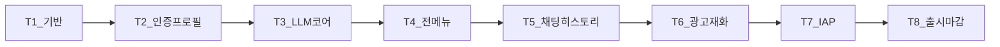

# 가화만사성 구현 계획 (분할)

> 기준: [docs/가화만사성-설계안.md](가화만사성-설계안.md), [RULE.md](../RULE.md)  
> 출시 목표는 A안(전체 기능)이지만, **구현은 아래 트란치 단위로 끊어서** 진행한다.

---

## 분할 원칙

1. 각 트란치가 끝나면 **실행·검증 가능한 상태**를 만든다.
2. 뒤 단계가 앞 단계 DB/API에 의존하므로 **순서를 건너뛰지 않는다**.
3. 콘솔 작업(Supabase 프로젝트 생성, OAuth 키, Play IAP, AdMob)은 코드와 병행하되, **값이 없어도 스캐폴드·마이그레이션·더미 UI는 진행** 가능.
4. 한 대화/세션 권장 단위: **트란치 1개** (최대 트란치 1+2만).

---

## 트란치 맵

| 트란치 | 설계 Phase | 산출물 (Done 정의) | 예상 규모 |
|--------|------------|-------------------|-----------|
| **T1 기반** | P0 | Flutter 앱 생성, 테마/라우팅 뼈대, `.env.example`, DB migrations+RLS SQL, personas 원본 6 md | S~M |
| **T2 인증·프로필** | P1 | Google/Kakao 로그인 화면, users upsert, 온보딩 프로필, members CRUD, 메인 셸 | M |
| **T3 LLM 코어** | P2 | 만세력 유틸, `generate-fortune` Edge, 내 운세+가족궁합 E2E (부적 차감·결과 JSON UI) | L |
| **T4 전 메뉴** | P3 | 동료·택일·작명·꿈 입력 마법사 + 동일 API 연동 | L |
| **T5 채팅·히스토리** | P4 | `ask-followup`, 쌀알 5턴, 설정 히스토리 목록/상세 | M |
| **T6 광고·일일재화** | P5 | 배너/리워드/네이티브(테스트 ID), daily-grant, claim-reward | M |
| **T7 IAP** | P6 | 상품 목록 UI, verify-iap, 패스 한도, purchases/ledger | M |
| **T8 출시 마감** | P7 | 면책·약관·탈퇴, 스토어 메타, 비공개 테스트 체크리스트 | S~M |

---

## 트란치별 작업 체크리스트

### T1 — 기반 (지금 시작 권장)
- [x] `flutter create` → `applicationId`: `com.janny.gahwa_luck` (`app/`)
- [x] 폴더: `lib/core`, `lib/features/*`, 테마(베이지·紅黃黑)
- [x] 메인 placeholder 6 메뉴 + 면책 문구
- [x] `.env.example` + README 실행 방법
- [x] `supabase/migrations/20260921000001_init.sql` (users, members, fortunes, fortune_chats, purchases, wallet_ledger + RLS)
- [x] `personas/*.md` 6종
- [x] Riverpod / google_mobile_ads / in_app_purchase pubspec 예약
- [ ] Android cmdline-tools 정상 + `flutter doctor --android-licenses` (Studio SDK Manager에서 설치 필요 — zip 손상)
- [ ] 실제 기기/에뮬 APK 실행 확인

### T2 — 인증·프로필
- [x] supabase_flutter 연동
- [x] 로그인 UI (Google + Kakao) — 키는 env
- [x] 최초 프로필 온보딩 (선택형 생년월일 등)
- [x] members 추가/삭제/정렬
- [x] 메인 상단: 부적/쌀알 표시(서버 값)

**검증**: 로그인 → 프로필 저장 → 멤버 추가 → 메인 진입.

### T3 — LLM 코어 (첫 가치 전달)
- [ ] Dart 만세력 → four_pillars
- [ ] Edge `generate-fortune` + Dual-Key Gemini
- [ ] 부적 차감 트랜잭션
- [ ] 내 운세 / 가족궁합 입력→결과 화면
- [ ] 생성 중 로딩(부적 애니메이션) placeholder

**검증**: 실제 또는 모킹으로 결과 JSON 렌더, fortunes row 생성.

### T4 — 나머지 메뉴
- [ ] 동료 / 날 받기 / 이름받기 / 꿈해몽 마법사(선택형 UX)
- [ ] category별 동일 Edge 호출

**검증**: 6개 category 모두 저장·재열람 가능.

### T5 — 추가질문·히스토리
- [ ] Edge `ask-followup` + 슬라이딩 윈도우
- [ ] 결과 하단 채팅 UI, suggested_questions 원탭
- [ ] 설정 > 히스토리

**검증**: 쌀알 차감·5턴 제한·히스토리에서 재오픈.

### T6 — 광고·일일
- [ ] AdMob 테스트 단위, 배너/리워드/네이티브 슬롯
- [ ] `daily-grant`, `claim-reward` + 일일 한도

**검증**: 테스트 리워드 시청 후 잔액 증가, 자정 로직(또는 수동 트리거) 동작.

### T7 — IAP
- [ ] Play 상품 ID 상수 + 상점 화면
- [ ] `verify-iap` + token UNIQUE
- [ ] 패스 시 배너 숨김·일일 한도

**검증**: 라이선스 테스트 구매 → 서버 지급 (샌드박스).

### T8 — 출시 마감
- [ ] 면책, 약관 링크, 탈퇴 API/UI
- [ ] 처리방침 URL 연결
- [ ] AAB 서명·비공개 테스트 트랙 업로드 가이드

**검증**: 스토어 체크리스트 전부 체크.

---

## 의존·블로커 (사용자 측)

| 항목 | 필요 시점 | 비고 |
|------|-----------|------|
| Supabase URL / anon key | T2 | T1은 SQL만 작성 가능 |
| Google/Kakao OAuth 설정 | T2 | |
| Gemini API keys (Edge secret) | T3 | 없으면 mock 모드로 T3 UI만 |
| AdMob 앱/단위 (테스트 ID로 대체 가능) | T6 | |
| Play Console IAP 상품·서비스계정 | T7 | |

---

## 세션 진행 제안

| 옵션 | 범위 | 추천 상황 |
|------|------|-----------|
| **A (권장)** | **T1만** | 지금 바로 코드 착수, 기반 안정화 |
| **B** | **T1 + T2** | Supabase·OAuth 키를 바로 넣을 수 있을 때 |
| **C** | T1→T3까지 연속 | 키가 준비됐고 한 번에 코어 데모가 필요할 때 |

전체 T1~T8을 한 세션에 끝내는 것은 비권장(품질·리뷰 어려움).

---

## 이번 확인 요청

아래 중 골라 주세요.

1. **이번 구현 범위**: `A(T1)` / `B(T1+T2)` / `C(T1~T3)` / 기타(직접 지정)
2. Supabase·OAuth·Gemini 키: **지금 있음** / **나중에 `.env`만 채움** (코드는 빈 예시로)
